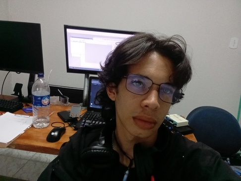
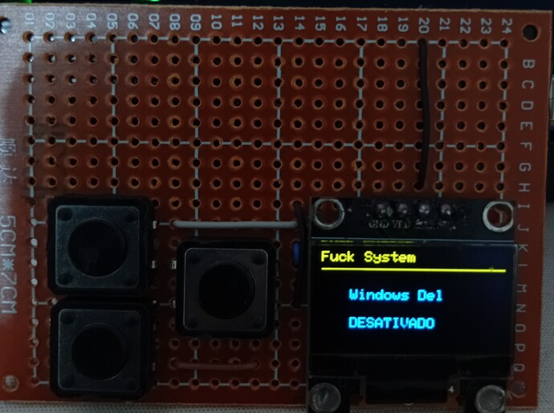
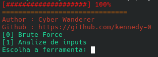
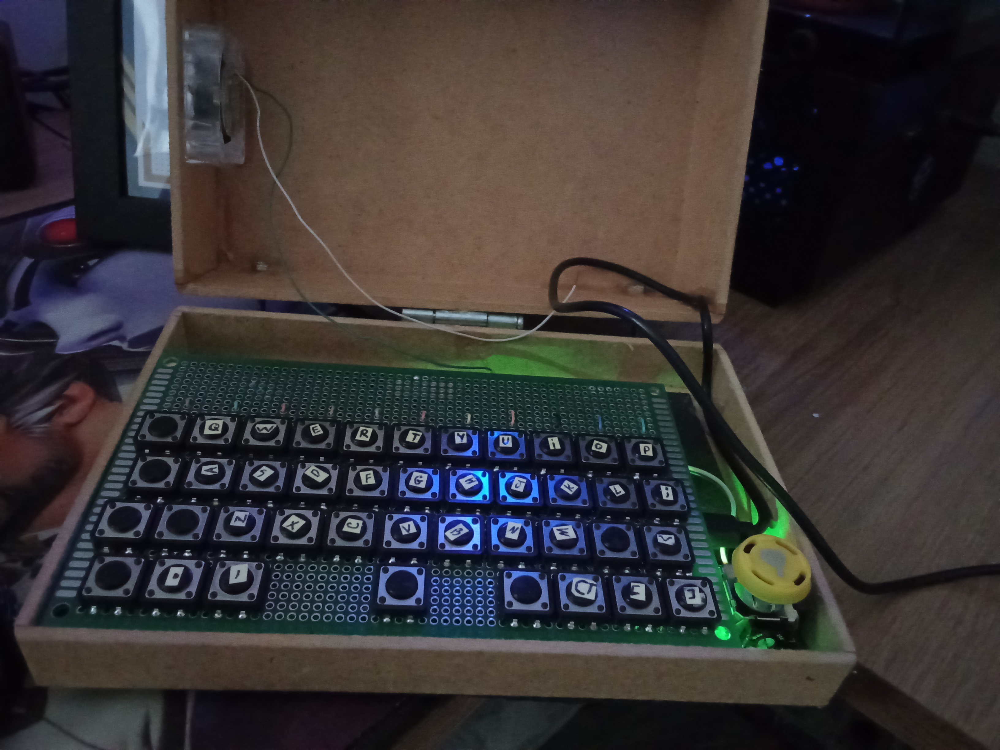

# Cyber Wanderer | Portfólio de Daniel Kennedy

Portfólio pessoal de **Daniel Kennedy**, desenvolvedor de Sistemas Embarcados e Automação. O site apresenta meus projetos que integram hardware e software, usando Arduino, ESP32, Raspberry Pi, Python, C/C++ e Linux.



## Sobre o site

Site estático de página única (SPA simples), com navegação entre seções sem recarregar a página:

- **Início**: apresentação pessoal
- **Projetos**: cards com os principais projetos e links para os repositórios
- **GitHub**: botão que abre meu perfil em uma nova aba

### Recursos

- Layout responsivo (desktop, tablet e celular) com `clamp()`, CSS Grid e Flexbox
- Navegação entre páginas com JavaScript puro e animação de entrada
- Tema escuro em tons de roxo
- Sem frameworks e sem dependências

## Projetos em destaque

### KeyDeck
Dispositivo baseado no **RP2040** que usa **USB HID** para simular um teclado conectado ao computador. Possui interface própria com **display OLED** e **botões físicos**, permitindo navegar por um menu e executar funções programadas.



Repositório: https://github.com/kennedy-0/KeyDeck

### LoginTestLab
Projeto em **Python** com **Selenium** para estudo de automação de testes de autenticação. Automatiza a interação com um formulário de login **em ambiente autorizado**, permitindo testar diferentes entradas e validar o comportamento do sistema.



Repositório: https://github.com/kennedy-0/LoginTestLab

> ⚠️ Uso exclusivamente educacional e em ambientes próprios ou com autorização expressa.

### Cyber-Deck
Computador portátil construído do zero, inspirado no livro *Neuromancer*. Integra hardware e software em uma plataforma personalizada para programação, automação e administração de sistemas.



**Status:** em desenvolvimento (fase de configuração do sistema operacional).

## Tecnologias

| Camada | Tecnologia |
|---|---|
| Estrutura | HTML5 |
| Estilo | CSS3 (Grid, Flexbox, media queries, animações) |
| Interatividade | JavaScript (ES6) |
| Hospedagem | GitHub Pages |

## Estrutura do projeto

```
.
├── index.html
├── css/
│   └── style.css
├── js/
│   └── main.js
├── assets/
│   ├── I.jpg
│   ├── KeyDeck.jpg
│   ├── interface.png
│   └── tec.jpg
└── README.md
```

## Como executar localmente

```bash
# 1. Clone o repositório
git clone https://github.com/kennedy-0/NOME-DO-REPOSITORIO.git

# 2. Entre na pasta
cd NOME-DO-REPOSITORIO

# 3. Abra o index.html no navegador
# ou use um servidor local:
python3 -m http.server 8000
# acesse http://localhost:8000
```

## Como publicar no GitHub Pages

1. Envie os arquivos para o repositório (branch `main`).
2. Vá em **Settings → Pages**.
3. Em **Build and deployment → Source**, escolha **Deploy from a branch**.
4. Selecione a branch **main** e a pasta **/ (root)** e clique em **Save**.
5. Aguarde 1 a 2 minutos. O site ficará em:
   `https://kennedy-0.github.io/NOME-DO-REPOSITORIO/`

## Contato

- GitHub: [@kennedy-0](https://github.com/kennedy-0)

## Licença

Projeto pessoal. Todos os direitos reservados © Daniel Kennedy.
